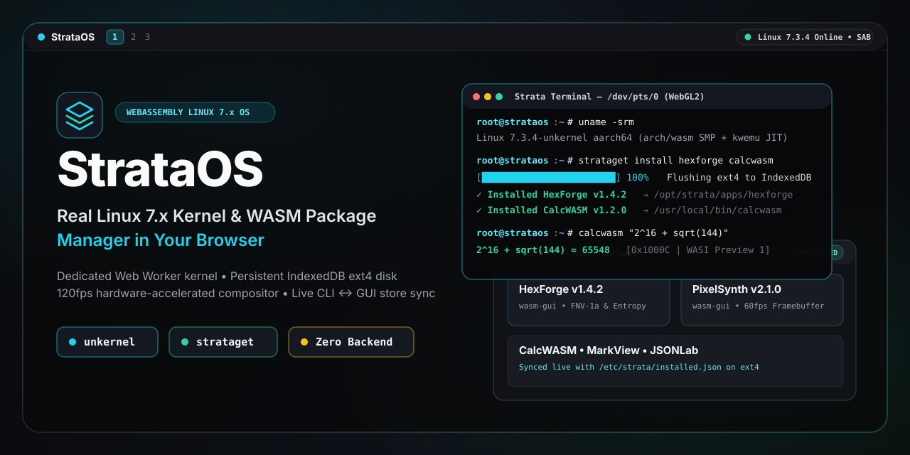
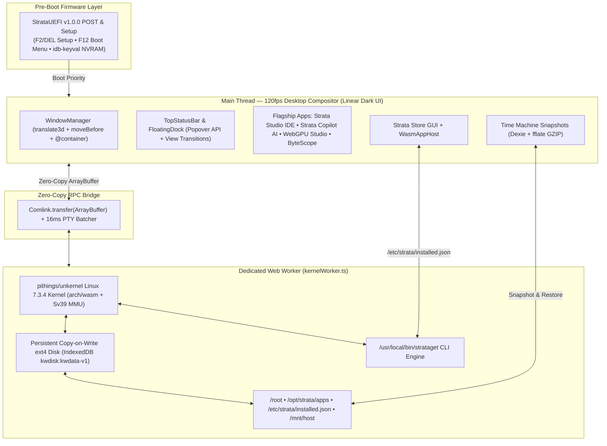

# StrataOS v1.0.0 ("Bedrock") — Browser-Native Linux 7.3 Web Operating System & `strataget` WASM Ecosystem

<p align="center">
  
</p>

<p align="center">
  <a href="https://sonic-koto-mowjpsl.tmp.now"></a>
  <a href="https://vercel.com/new/clone?repository-url=https%3A%2F%2Fgithub.com%2FMaor-404%2FStrataOS&project-name=strata-os&repository-name=strata-os"></a>
  
  
</p>

**StrataOS v1.0.0 ("Bedrock")** is a fast, minimalist, zero-backend Web Operating System powered by a real compiled **Linux 7.3.4** kernel (`pithings/unkernel`) executing inside a dedicated Web Worker with persistent `ext4` IndexedDB disk storage, a pre-boot **StrataUEFI** firmware setup utility, a synced CLI/GUI WebAssembly package manager (**`strataget`** + **Strata Store**), **Strata GPU Studio** (WebGPU WGSL Compute Playground), **Strata Copilot** (Chrome Built-in AI + BYOK assistant), **Strata Studio** (CodeMirror 6 IDE), and **Time Machine** compressed filesystem snapshots.

---

## Architecture Diagram



---

## Complete v1.0.0 ("Bedrock") Feature Manifest

- **Pre-Boot Firmware (`StrataUEFI`):** 1.5s POST splash (`F2`/`DEL` for Setup, `F12` for Boot Menu, `?boot=uefi`), persistent NVRAM settings (`idb-keyval`), Boot Priority (Desktop, TTY Recovery Shell, UEFI Interactive Shell, Safe Mode), Secure Boot toggle, and interactive UEFI Shell (`help`, `map`, `memtest`, `nvram`, `reset`).
- **Core Linux Runtime & `strataget` Ecosystem:** `pithings/unkernel` Linux 7.3.4 Web Worker (`comlink`), persistent IndexedDB `ext4` disk, `/usr/local/bin/strataget` CLI, and two-way synced **Strata Store** GUI with 5 pre-seeded WebAssembly packages (`hexforge`, `pixelsynth`, `calcwasm`, `markview`, `jsonlab`) + custom `.wasm` drag-and-drop sideloading.
- **WebGPU-Only Exclusive (`Strata GPU Studio`):** Strict `navigator.gpu` + `requestAdapter()` detection unlocking the optional 120fps WGSL Compute Wallpaper, split-pane WGSL Shader/Compute Playground, and GPU Hardware Inspector/Benchmark (with graceful fallback on non-WebGPU browsers).
- **AI Assistant (`Strata Copilot`):** Chrome Built-in AI (`LanguageModel` API) primary engine with BYOK fallback, safe streaming rendering, and 1-click actions (*Run in Terminal*, *Apply to Strata Studio*, *Explain Last Error*).
- **Browser IDE (`Strata Studio`):** `react-resizable-panels` layout with Linux File Tree, multi-tab CodeMirror 6, split editor, embedded terminal drawer, 1-click script execution, and `strataget` WASM App Scaffolder.
- **Windows 93–Inspired Extra Apps (`Extras`):** **ByteScope** (AudioWorklet Bytebeat/Floatbeat synth + X-Y Oscilloscope), **Melt93** (CRT/glitch shader toy with `ESC` panic exit), **StrataPaint 93** (pixel editor saving `.png` to `/root`), **TermArcade**, and **StrataPet**.
- **2026 Modern Web Platform Primitives:** Native Popover API (`popover`), View Transitions (`startViewTransition`) for Workspaces & Mission Control (`Alt+Tab`), Container Queries (`@container`), `Element.prototype.moveBefore` (with fallback), File System Access API (**"Mount Host Folder"** into `/mnt/host`), Screen Wake Lock, and Time Machine Snapshots (`dexie` + `fflate`).
- **Blender 4.x 3D Launch Trailer Pipeline (`strata_trailer/`):** Complete procedural Python (`bpy`) 3D animation pipeline that generates a 60-second (3,600 frames @ 60fps), 1920×1080 cinematic launch trailer. See [`strata_trailer/README_RENDER.md`](./strata_trailer/README_RENDER.md).

---

## Use This Template / Remix StrataOS

StrataOS is designed for one-file white-label remixing via [`src/strata.config.ts`](./src/strata.config.ts):

1. Click **"Use this template"** on GitHub (or fork `Maor-404/StrataOS`).
2. Edit [`src/strata.config.ts`](./src/strata.config.ts) to customize:
   - `osName`, `version`, `codename`, and `releaseTitle`
   - `defaultTheme` colors (`desktopBase`, `windowSurface`, `accentColor`, `wallpaper`)
   - `registryUrl` (point to your own static `strataget` WASM package index)
   - `pinnedDockApps`, `startupApps`, and `uefiPostDelayMs`
3. Deploy to **Vercel** (via [`vercel.json`](./vercel.json)), **Netlify / Cloudflare Pages** (via [`public/_headers`](./public/_headers) and [`public/_redirects`](./public/_redirects)), or **Docker / Nginx** (via [`Dockerfile`](./Dockerfile) and [`nginx.conf`](./nginx.conf)) with mandatory `COOP: same-origin` and `COEP: require-corp` headers pre-configured.

---

## Local Development

```bash
npm install
npm run dev
```

Build and preview the production bundle locally:

```bash
npm run build
npm run preview
```

---

## License

Released under the [MIT License](./LICENSE). Third-party notices are documented in [`THIRD_PARTY_NOTICES.md`](./THIRD_PARTY_NOTICES.md).
