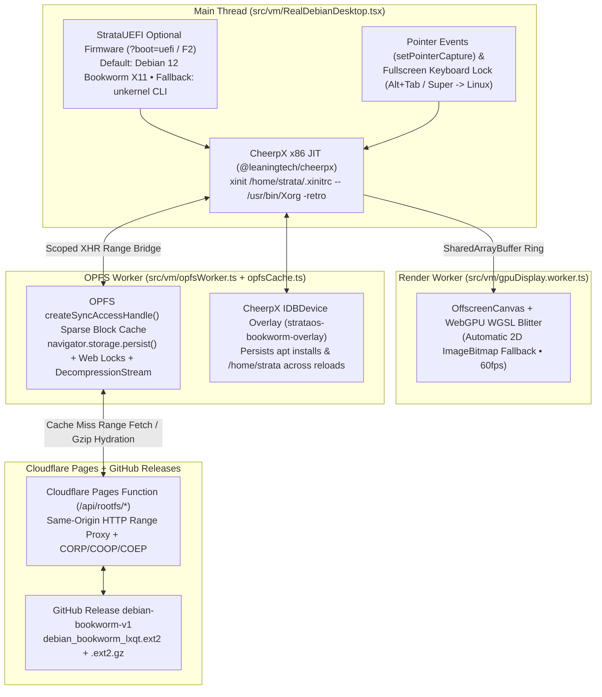

# StrataOS — Real Debian 12 (Bookworm) + Lightweight LXQt/Openbox X11 VM

<p align="center">
  <strong>Boot a real Debian 12 Bookworm (<code>i386</code>) X11 virtual machine running Openbox + LXQt-panel + PCManFM-Qt + QTerminal directly inside one browser tab via CheerpX — supercharged with OPFS <code>createSyncAccessHandle()</code> disk caching, an <code>OffscreenCanvas</code> + WebGPU framebuffer blitter, persistent <code>apt</code> overlay storage, and <code>StrataUEFI</code> + <code>unkernel</code> CLI recovery. Zero login. 100% static Cloudflare Pages hosting.</strong>
</p>

<p align="center">
  <a href="https://strata-os.pages.dev"></a>
  <a href="https://strata-os.pages.dev/?boot=uefi"></a>
  <a href="https://strata-os.pages.dev/?boot=tty"></a>
  <a href="https://github.com/Maor-404/StrataOS/actions/workflows/build-debian-vm.yml"></a>
</p>

---

## Architecture



---

## Core Components

- **Lean Debian 12 Bookworm + LXQt/Openbox Guest ([`dockerfiles/debian_bookworm_lxqt/Dockerfile`](./dockerfiles/debian_bookworm_lxqt/Dockerfile)):**
  - `i386/debian:bookworm-slim` with `xorg`, `xinit`, `xserver-xorg-video-fbdev`, `xserver-xorg-input-evdev`, `dbus-x11`, `openbox`, `lxqt-panel`, `pcmanfm-qt`, `qterminal`, `lxqt-config`, `lxqt-themes`, `papirus-icon-theme`, `fonts-dejavu-core`, `sudo`, `curl`, `nano`, `neofetch`, `htop`.
  - Default user `strata` (password `strata`, passwordless `sudo`), launching `openbox &`, `lxqt-panel &`, and `exec pcmanfm-qt --desktop` with zero heavy compositor lag.
- **Automated Cloud `.ext2` Builder ([`.github/workflows/build-debian-vm.yml`](./.github/workflows/build-debian-vm.yml)):**
  - Builds `dockerfiles/debian_bookworm_lxqt` with `docker buildx build --platform=linux/386`, packs a revision-0 bootable `debian_bookworm_lxqt.ext2` (via `mke2fs -t ext2 -r 0 -d`) plus `debian_bookworm_lxqt.ext2.gz`, and publishes both to GitHub Release tag `debian-bookworm-v1`.
- **Ultra-Fast OPFS Block Cache ([`src/vm/opfsCache.ts`](./src/vm/opfsCache.ts) + [`src/vm/opfsWorker.ts`](./src/vm/opfsWorker.ts)):**
  - Dedicated Web Worker using `FileSystemFileHandle.createSyncAccessHandle()`, `navigator.storage.persist()`, and `navigator.locks` (multi-tab corruption protection) to cache streamed 64 KiB ext2 blocks locally and optionally unpack `.ext2.gz` via native `DecompressionStream('gzip')` for fast repeat boots.
- **Zero-Jank OffscreenCanvas + WebGPU Display ([`src/vm/gpuDisplay.ts`](./src/vm/gpuDisplay.ts) + [`src/vm/gpuDisplay.worker.ts`](./src/vm/gpuDisplay.worker.ts)):**
  - Transfers `<canvas>` via `transferControlToOffscreen()`, transports X11 frames over `SharedArrayBuffer`, and blits at 60fps using a WebGPU WGSL shader (with automatic 2D `ImageBitmap` fallback), wired with `setPointerCapture` and Fullscreen Keyboard Lock (`Alt+Tab`, `Ctrl+W`, `Super`).
- **StrataUEFI + Lightweight `unkernel` CLI Recovery ([`src/shell/StrataUEFI.tsx`](./src/shell/StrataUEFI.tsx)):**
  - Press `F2` during boot or visit `?boot=uefi` for StrataUEFI setup, or `?boot=tty` to boot the lightweight `unkernel` Linux 7.3 CLI recovery shell on demand.

---

## Deploy to Cloudflare Pages (Primary Free Unlimited-Bandwidth Host)

StrataOS is pre-configured for **Cloudflare Pages** via [`public/_headers`](./public/_headers), [`public/_redirects`](./public/_redirects), [`functions/api/rootfs/[[path]].ts`](./functions/api/rootfs/%5B%5Bpath%5D%5D.ts), and [`wrangler.toml`](./wrangler.toml) (while keeping [`vercel.json`](./vercel.json) intact):

1. Connect `Maor-404/StrataOS` in **Cloudflare Dashboard -> Workers & Pages -> Create -> Pages**.
2. Use these exact build settings:
   - **Build command:** `npm run build`
   - **Build output directory:** `dist`
   - **Environment variable:** `NODE_VERSION=20`
3. Deploy — Cloudflare Pages serves `Cross-Origin-Opener-Policy: same-origin` and `Cross-Origin-Embedder-Policy: require-corp` (required for `SharedArrayBuffer` and OPFS `createSyncAccessHandle()`), deploys the `/api/rootfs/*` same-origin Range proxy function automatically, and keeps every static asset in `dist/` strictly under 25 MiB.

Test locally with Wrangler:

```bash
npm run preview:cf
```

---

## Use This Template / Remix StrataOS

StrataOS supports one-file white-label remixing via [`src/strata.config.ts`](./src/strata.config.ts):

1. Fork or clone `Maor-404/StrataOS`.
2. Customize branding, default theme, `liveDemoUrl`, `registryUrl`, and `pinnedDockApps` in [`src/strata.config.ts`](./src/strata.config.ts).
3. *(Optional)* Bundle the full ~57 MiB `unkernel` Debian 13 EROFS rootfs split into `<20 MiB` Cloudflare-safe chunks:
   ```bash
   node scripts/fetch-debian-rootfs.mjs
   ```

---

## Local Development

```bash
npm install
npm run dev
```

Build and preview the production bundle locally:

```bash
npm run build
npm run preview
```

---

## License

Released under the [MIT License](./LICENSE). Third-party notices are documented in [`THIRD_PARTY_NOTICES.md`](./THIRD_PARTY_NOTICES.md).
