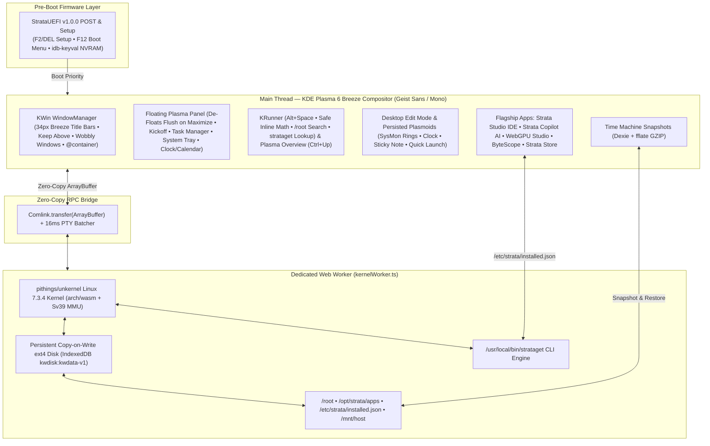

# StrataOS v1.0.0 ("Bedrock") — Real Linux 7.x + KDE Plasma 6 in One Tab

<p align="center">
  <strong>Boot a real compiled Linux 7.3.4 kernel past working UEFI firmware into a KDE Plasma 6 Breeze desktop — with persistent <code>ext4</code> storage, the <code>strataget</code> WASM package manager, WebGPU Compute Studio, and Chrome Built-in AI Copilot — directly inside one browser tab. Zero login. Zero backend.</strong>
</p>

<p align="center">
  <a href="https://sonic-koto-mowjpsl.tmp.now"></a>
  <a href="https://vercel.com/new/clone?repository-url=https%3A%2F%2Fgithub.com%2FMaor-404%2FStrataOS&project-name=strata-os&repository-name=strata-os"></a>
  <a href="https://sonic-koto-mowjpsl.tmp.now/?boot=uefi"></a>
  <a href="https://sonic-koto-mowjpsl.tmp.now/?app=webgpu"></a>
</p>

<p align="center">
  <a href="https://sonic-koto-mowjpsl.tmp.now">
    
  </a>
</p>

> **15-Second Demo GIF / 3D Launch Trailer Slot:** Record a 15-second capture (`POST -> Plasma 6 -> strataget install pixelsynth -> hard refresh`) to `docs/media/demo.gif`, or render the included 60s Blender 4.x 3D launch trailer in [`strata_trailer/`](./strata_trailer/README_RENDER.md) and embed it here.

> **Deployment URL Note:** The live demo links above currently point to the active temporary Vercel deployment (`https://sonic-koto-mowjpsl.tmp.now`). Once a permanent custom or Vercel domain is claimed, update `liveDemoUrl` in [`src/strata.config.ts`](./src/strata.config.ts), [`index.html`](./index.html), and this README.

---

## 10-Second Live Proof (Zero-Backend Verification)

1. Click **[Launch Live Demo](https://sonic-koto-mowjpsl.tmp.now)** (no login or backend container).
2. Watch **StrataUEFI** POST into the **KDE Plasma 6 Breeze Dark** desktop (or jump straight to [`?boot=uefi`](https://sonic-koto-mowjpsl.tmp.now/?boot=uefi)).
3. Click the **3-Click Live Proof** card (or open Terminal and run `uname -a && strataget install pixelsynth`), then **hard-refresh your browser** — the installed WASM package persists on the IndexedDB-backed `ext4` disk.

---

## Architecture Diagram



---

## Complete v1.0.0 ("Bedrock") Feature Manifest

- **KDE Plasma 6 Breeze Desktop Environment:**
  - **Breeze Dark & Breeze Light Themes:** 95%-opaque Breeze Dark surfaces (`#1b1e20` base, `#232629` view/panel, `#31363b` header), Plasma Blue (`#3daee9`) accent with auto-contrast text (`contrast-color()` + CIE XYZ-D65 fallback), Breeze Light & System mode selector, custom accent color picker, and bundled **Geist Sans** + **Geist Mono** variable typography.
  - **Floating Plasma Panel:** Single bottom (or top) panel floating with 6px margin and `backdrop-filter: blur(20px) saturate(180%)` that automatically animates flush (`margin: 0`, `border-radius: 0`) whenever a window maximizes. Includes the **Kickoff** launcher (with GitHub star badge, Favorites/All/Extras tabs, and UEFI/Lock/Restart power actions), **Icons-only Task Manager**, **System Tray** (Kernel latency, WebGPU status, Notifications/Time Machine, Quick Settings with **Share This Setup** deep-link copier + `sonner` toasts, `^` hidden tray popover), **Digital Clock + Calendar** popup, and far-right **Peek at Desktop**.
  - **KRunner (`Alt+Space` / `Ctrl+K`):** Top-center search & command bar supporting app launch, `/root` file lookup, live `strataget` catalog install, system actions, and safe inline arithmetic (`256 * 12`).
  - **Desktop Edit Mode & Persisted Plasmoids:** Right-click the desktop -> **Enter Edit Mode** to zoom out the canvas and add draggable, resizable, IndexedDB-persisted widgets (**System Monitor rings**, **Analog/Digital Clock**, **Sticky Note**, and **Quick Launch**).
  - **KWin Window Manager & Plasma Overview (`Ctrl+Up` / `Alt+Tab`):** 34px Breeze title bars with centered titles and Keep Above/Pin, Minimize, Maximize, Close buttons; layered KWin shadows with active accent rim glow; optional **Wobbly Windows** toggle in Settings; and Plasma Overview with a Virtual Desktops 1–3 strip.
- **Pre-Boot Firmware (`StrataUEFI`):** 1.5s POST splash (`F2`/`DEL` for Setup, `F12` for Boot Menu, `?boot=uefi`), persistent NVRAM (`idb-keyval`), Boot Priority (Desktop, TTY Recovery Shell, UEFI Interactive Shell, Safe Mode), Secure Boot toggle, and working UEFI Shell (`help`, `map`, `memtest`, `nvram`, `reset`).
- **Core Linux Runtime & `strataget` Ecosystem:** `pithings/unkernel` Linux 7.3.4 Web Worker (`comlink`), persistent IndexedDB `ext4` disk, `/usr/local/bin/strataget` CLI, and two-way synced **Strata Store** GUI with 5 pre-seeded WASM packages (`hexforge`, `pixelsynth`, `calcwasm`, `markview`, `jsonlab`), custom `.wasm` sideloading, and a **Submit a WASM App** community CTA.
- **WebGPU-Only Exclusive (`Strata GPU Studio`):** Strict `navigator.gpu` + `requestAdapter()` detection unlocking the optional 120fps WGSL Compute Wallpaper, split-pane WGSL Shader/Compute Playground, and GPU Hardware Inspector/Benchmark.
- **AI Assistant (`Strata Copilot`):** Chrome Built-in AI (`LanguageModel` API) primary engine with BYOK fallback, streaming responses, and 1-click actions (*Run in Terminal*, *Apply to Strata Studio*, *Explain Last Error*).
- **Browser IDE (`Strata Studio`) & Extras:** Multi-pane CodeMirror 6 IDE with `strataget` WASM App Scaffolder, **ByteScope** (AudioWorklet Bytebeat synth + X-Y Oscilloscope), **Melt93** (CRT glitch toy), **StrataPaint 93**, **TermArcade**, **StrataPet**, **Mount Host Folder** into `/mnt/host`, and **Time Machine** compressed snapshots.
- **Launch & Growth Assets:** Organic launch playbook in [`docs/LAUNCH_PLAYBOOK.md`](./docs/LAUNCH_PLAYBOOK.md) and procedural Blender 4.x 3D launch trailer pipeline in [`strata_trailer/README_RENDER.md`](./strata_trailer/README_RENDER.md).

---

## Use This Template / Remix StrataOS

StrataOS supports one-file white-label remixing via [`src/strata.config.ts`](./src/strata.config.ts):

1. Fork or clone `Maor-404/StrataOS`.
2. Customize branding, default theme, `registryUrl`, `pinnedDockApps`, and `uefiPostDelayMs` in [`src/strata.config.ts`](./src/strata.config.ts).
3. Deploy with COOP/COEP headers pre-configured for **Vercel** ([`vercel.json`](./vercel.json)), **Netlify / Cloudflare Pages** ([`public/_headers`](./public/_headers), [`public/_redirects`](./public/_redirects)), or **Docker / Nginx** ([`Dockerfile`](./Dockerfile), [`nginx.conf`](./nginx.conf)).

---

## Deploy to Cloudflare Pages

StrataOS ships pre-configured for free, unlimited-bandwidth hosting on **Cloudflare Pages** via [`public/_headers`](./public/_headers), [`public/_redirects`](./public/_redirects), and [`wrangler.toml`](./wrangler.toml) (while keeping [`vercel.json`](./vercel.json) intact for multi-host compatibility):

1. Connect the `Maor-404/StrataOS` repository in **Cloudflare Dashboard -> Workers & Pages -> Create -> Pages**.
2. Use these exact build settings:
   - **Build command:** `npm run build`
   - **Build output directory:** `dist`
   - **Environment variable:** `NODE_VERSION=20`
3. Deploy — Cloudflare Pages automatically applies `Cross-Origin-Opener-Policy: same-origin`, `Cross-Origin-Embedder-Policy: require-corp`, `Cross-Origin-Resource-Policy: same-origin`, and SPA deep-link routing (`/* /index.html 200`).

Test the exact Cloudflare Pages header behavior locally with Wrangler:

```bash
npm run preview:cf
```

---

## Local Development

```bash
npm install
npm run dev
```

Build and preview the production bundle locally:

```bash
npm run build
npm run preview
```

---

## License

Released under the [MIT License](./LICENSE). Third-party notices are documented in [`THIRD_PARTY_NOTICES.md`](./THIRD_PARTY_NOTICES.md).
