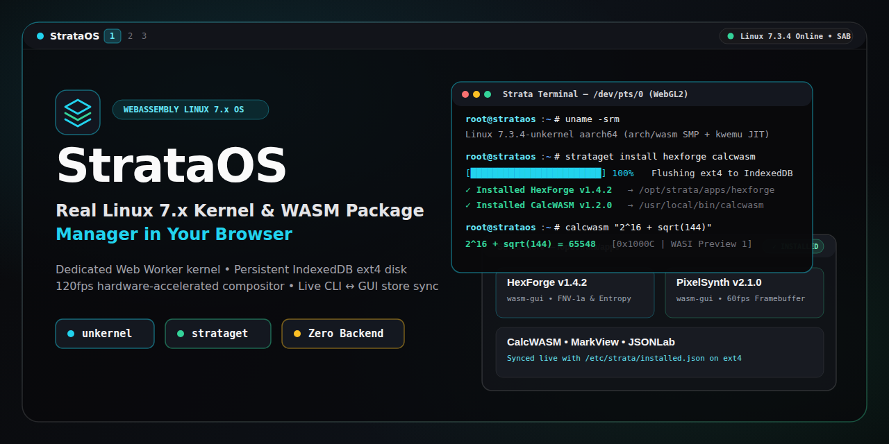
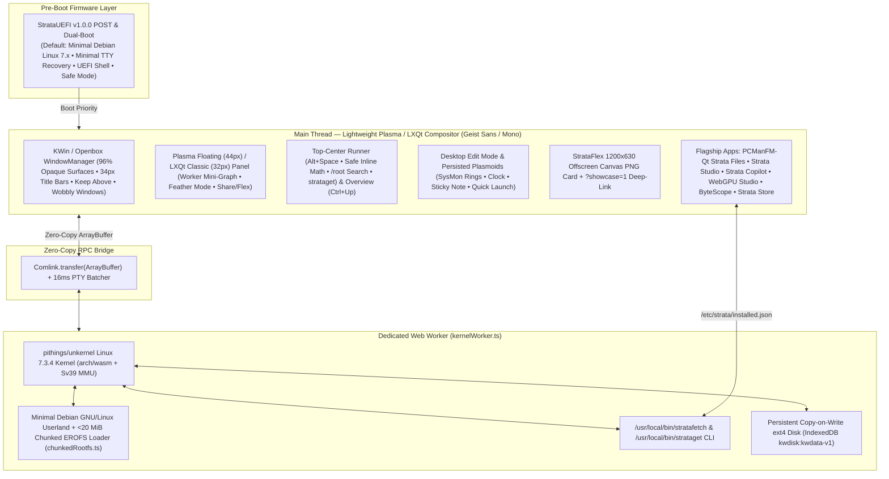

# StrataOS v1.0.0 ("Bedrock") — Minimal Debian Linux 7.x + Lightweight Plasma/LXQt in One Tab

<p align="center">
  <strong>Boot a real Minimal Debian GNU/Linux 7.3.4 kernel past working UEFI firmware into a lightweight Plasma/LXQt desktop — with <code>stratafetch</code>, persistent <code>ext4</code> storage, the <code>strataget</code> WASM package manager, WebGPU Compute Studio, and Chrome Built-in AI Copilot — directly inside one browser tab. Zero login. Zero backend.</strong>
</p>

<p align="center">
  <a href="https://strata-os.pages.dev/?showcase=1"></a>
  <a href="https://strata-os.pages.dev"></a>
  <a href="https://strata-os.pages.dev/?boot=uefi"></a>
  <a href="https://vercel.com/new/clone?repository-url=https%3A%2F%2Fgithub.com%2FMaor-404%2FStrataOS&project-name=strata-os&repository-name=strata-os"></a>
</p>

<p align="center">
  <a href="https://strata-os.pages.dev/?showcase=1">
    
  </a>
</p>

> **15-Second Demo GIF / 3D Launch Trailer Slot:** Record a 15-second capture (`?showcase=1 -> stratafetch -> strataget install pixelsynth -> hard refresh`) to `docs/media/demo.gif`, or render the included 60s Blender 4.x 3D launch trailer in [`strata_trailer/`](./strata_trailer/README_RENDER.md) and embed it here.

---

## 2-Second Instant Proof (`?showcase=1`)

1. Open **[`https://strata-os.pages.dev/?showcase=1`](https://strata-os.pages.dev/?showcase=1)** — skips POST directly into a clean 2-window layout: **Strata Terminal** running `stratafetch` on Debian Linux 7.3 alongside **WebGPU Studio** (or **ByteScope** fallback).
2. Click **Flex** in the System Tray (or on the **3-Click Live Proof** card) to render and copy a live **`1200×630` StrataFlex PNG Proof Card** with your real kernel version, boot time (ms), WebGPU adapter, and active Plasma/LXQt theme.
3. Run `strataget install pixelsynth`, then **hard-refresh your browser** — the package persists on the IndexedDB-backed `ext4` filesystem.

---

## Architecture Diagram



---

## Complete v1.0.0 ("Bedrock") Feature Manifest

- **Minimal Debian GNU/Linux Guest (`src/kernel/`):**
  - Boots real Linux 7.3.4 (`pithings/unkernel`, 9.7 MiB WASM — strictly under Cloudflare Pages' 25 MiB limit) provisioned as **`Debian GNU/Linux (StrataOS Bedrock Edition)`** (`/etc/os-release`, `/etc/debian_version`, `/root/Desktop`, `/root/.local/share/Trash`, `/mnt/host`).
  - Pre-installed **`/usr/local/bin/stratafetch`** displays an ASCII Debian + StrataOS swirl alongside live `uname -r`, kernel boot time (ms), memory/storage stats, active Plasma/LXQt theme, and `strataget` package count.
  - Built-in **`ChunkedHttpBlockDevice`** ([`src/kernel/chunkedRootfs.ts`](./src/kernel/chunkedRootfs.ts)) transparently streams `<20 MiB` split EROFS chunks from `/kernel/debian-manifest.json` if you optionally bundle `unkernel`'s full Debian 13 image via `node scripts/fetch-debian-rootfs.mjs`.
- **Customized Lightweight Plasma / LXQt Environment:**
  - **3 Persisted Global Themes (`idb-keyval`):** **Debian Crimson** (signature default: `#161317` slate, `#1e1a20` 96%-opaque windows, Debian Ruby Red `#d70a53` with `contrast-color()` auto-legibility, subtle procedural Debian swirl wallpaper), **Strata Obsidian** (`#0b0d10` charcoal, `#38bdf8` ice-blue accents, floating pill panel), and **LXQt Frost / Breeze Light**.
  - **LXQt Feather Mode:** Instant Quick Settings & Settings toggle that strips all `backdrop-filter` blur and shadows for 60fps performance on low-end GPUs, paired with snappy `120ms` transitions.
  - **Floating Plasma (44px) & LXQt Classic (32px) Panel:** Switch between Plasma's auto-flushing floating panel and a razor-thin `32px` LXQt Classic bar with compact `1 | 2 | 3` workspace switcher, live CPU/Worker RPC mini-graph, Kickoff/LXQt Application Menu, System Tray, Calendar, and Peek at Desktop.
  - **Top-Center Runner (`Alt+Space` / `Ctrl+K`):** App launch, `/root` file search, `strataget` lookup, and safe inline arithmetic (`256 * 12`).
  - **PCManFM-Qt Inspired Strata Files:** Compact *Places* sidebar (*Home*, *Desktop*, *Trash*, *Mount Host Folder*) + clickable path breadcrumb bar + Move-to-Trash support.
  - **Desktop Edit Mode & Persisted Plasmoids:** Right-click desktop -> **Enter Edit Mode** to drag and resize System Monitor rings, Analog/Digital Clock, Sticky Note, and Quick Launch widgets.
- **StrataFlex Proof Card & `?showcase=1`:** 1-click offscreen-canvas `1200×630` PNG proof card (Copy Image, Download PNG, Post to X / Reddit) + `?showcase=1` 2-window instant demo.
- **Full Flagship Stack Preserved:** **StrataUEFI** (default: *StrataOS — Minimal Debian (Linux 7.x)* + Minimal TTY Recovery fallback), **`strataget`** + **Strata Store** (5 starter WASM apps + `.wasm` sideloading + Submit a WASM App CTA), **Strata GPU Studio** (WebGPU WGSL Compute), **Strata Copilot** (Chrome Built-in AI + BYOK), **Strata Studio** (CodeMirror 6 IDE), **ByteScope**, **Melt93**, **StrataPaint 93**, **TermArcade**, **StrataPet**, and **Time Machine** compressed snapshots.
- **Launch & Growth Assets:** Organic launch playbook in [`docs/LAUNCH_PLAYBOOK.md`](./docs/LAUNCH_PLAYBOOK.md) and procedural Blender 4.x 3D launch trailer pipeline in [`strata_trailer/README_RENDER.md`](./strata_trailer/README_RENDER.md).

---

## Deploy to Cloudflare Pages (Primary Free Unlimited-Bandwidth Host)

StrataOS is pre-configured for **Cloudflare Pages** via [`public/_headers`](./public/_headers), [`public/_redirects`](./public/_redirects), and [`wrangler.toml`](./wrangler.toml) (while keeping [`vercel.json`](./vercel.json) intact as a secondary mirror):

1. Connect `Maor-404/StrataOS` in **Cloudflare Dashboard -> Workers & Pages -> Create -> Pages**.
2. Use these exact build settings:
   - **Build command:** `npm run build`
   - **Build output directory:** `dist`
   - **Environment variable:** `NODE_VERSION=20`
3. Deploy — Cloudflare Pages automatically serves `Cross-Origin-Opener-Policy: same-origin`, `Cross-Origin-Embedder-Policy: require-corp`, `X-Content-Type-Options: nosniff`, cross-origin WASM/kernel/registry headers, and SPA deep-link routing (`/* /index.html 200`).
4. *(Optional Custom Domain)* Bind your custom domain in Cloudflare Pages, then set the GitHub Repository Variable `SITE_URL` (`Settings -> Secrets and variables -> Actions -> Variables`) so [`.github/workflows/uptime-monitor.yml`](./.github/workflows/uptime-monitor.yml) monitors your custom domain every 6 hours and auto-manages `incident` issues.

Test the exact Cloudflare Pages header behavior locally with Wrangler:

```bash
npm run preview:cf
```

---

## Use This Template / Remix StrataOS

StrataOS supports one-file white-label remixing via [`src/strata.config.ts`](./src/strata.config.ts):

1. Fork or clone `Maor-404/StrataOS`.
2. Customize branding, default theme, `liveDemoUrl`, `registryUrl`, and `pinnedDockApps` in [`src/strata.config.ts`](./src/strata.config.ts).
3. *(Optional)* Bundle the full ~57 MiB `unkernel` Debian 13 EROFS rootfs split into `<20 MiB` Cloudflare-safe chunks:
   ```bash
   node scripts/fetch-debian-rootfs.mjs
   ```

---

## Local Development

```bash
npm install
npm run dev
```

Build and preview the production bundle locally:

```bash
npm run build
npm run preview
```

---

## License

Released under the [MIT License](./LICENSE). Third-party notices are documented in [`THIRD_PARTY_NOTICES.md`](./THIRD_PARTY_NOTICES.md).
